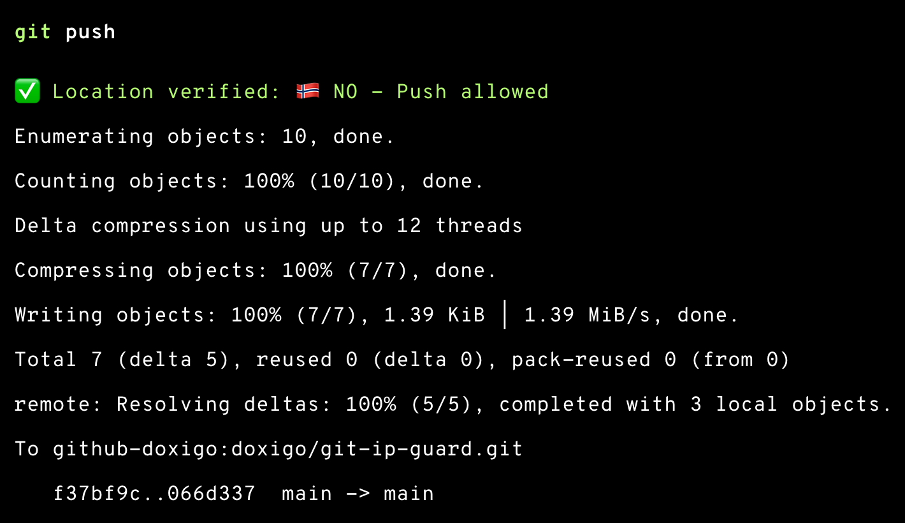
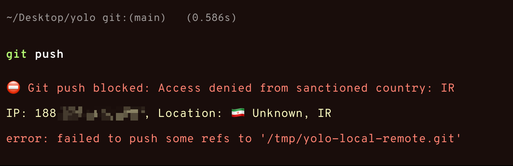
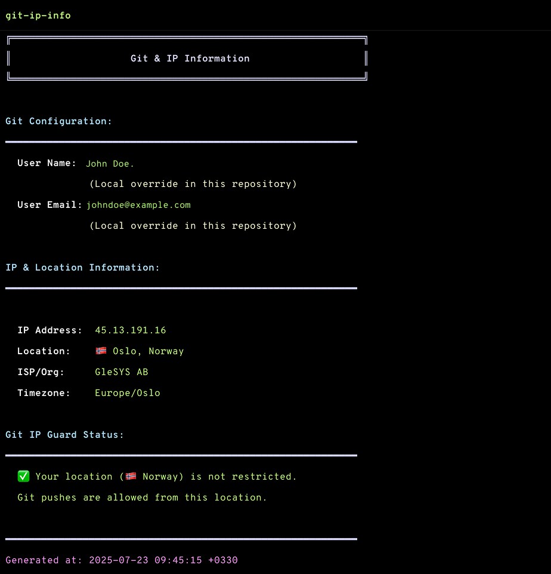

# Git IP Guard 3.0

A developer-side reminder that stops git from talking to your remotes while your public IP is in a sanctioned country. It checks the IP's location before git connects over SSH, and before pushes and pulls in your hooks.

## What this is — and what it isn't

Git IP Guard is a **local guardrail**, not a security control.

- It runs entirely on the developer's machine.
- A determined user can bypass it with `IPCHECK_BYPASS=1`, by setting `GIT_SSH_COMMAND`, by editing git config, by using a VPN, or by removing the tool.
- For real enforcement (CI checks, server-side validation, branch protection), you need server-side controls. This tool is for the case where someone *wants* compliance and wants the friendly reminder.

## Why this exists

Sanctions affect a lot of people who have nothing to do with the politics. This tool helps developers who need to demonstrate good-faith compliance with location-based restrictions while keeping clear escape hatches when those restrictions conflict with day-to-day work. It is transparent about what it does and does not promise.

## How it works

| Operation | SSH remote (`git@github.com:…`) | HTTPS remote |
|---|---|---|
| clone, fetch, pull, ls-remote, submodules | **Checked before git connects** | Checked after the fetch, when the pull merges or rebases (a reminder: the remote has already been contacted) |
| push | **Checked before git connects** (`--no-verify` doesn't skip it) | Checked by the `pre-push` hook, before anything is sent |
| local merge, rebase, commit | Never checked | Never checked |

- **SSH**: the installer sets `core.sshCommand` to `git-ip-guard-ssh`, which runs the check and then hands over to `ssh` — or to the `core.sshCommand` you had before, which is kept. This covers every repo at once, with no per-repo files.
- **Hooks**: one script, installed as `pre-push`, `pre-merge-commit`, `pre-rebase` and `post-merge`. The merge and rebase hooks only check while `git pull` is running (`GIT_REFLOG_ACTION`), so local merges and rebases never do a lookup and keep working offline. `post-merge` runs after a fast-forward pull has already landed, so it can only warn.

If you want nothing to leave the machine from the wrong place, git or otherwise, use a network-level kill switch such as [Whereabouts](https://github.com/doxigo/whereabouts).

## Features

- **Multi-provider IP geolocation** with automatic fallback: ipinfo.io → ipwho.is → api.country.is → freeipapi.com. A provider's answer must be JSON with an IP and a two-letter country, so a bot-challenge page or an error body is never read as a location.
- **Route-aware cache**: one lookup serves git operations for 5 minutes, but only while traffic leaves the same way. A VPN app that adds routes changes the route when it connects or drops, which drops the cache at once.
- **Fails closed**: if no provider can verify your location, the operation is blocked with a clear message and a bypass hint.
- **Allowlist, blocklist, or both**, plus **region rules** for places an ISO country code can't express (Crimea, Donetsk and Luhansk under UA).
- **Granular bypass**: env var, repo-level or global git config, per operation (push/pull) or all.
- `git-ip-info` and `git-ip-control` companion commands.

## Screenshots

### ✅ Push allowed


### ⛔ Push blocked


### 📊 `git-ip-info`


## Requirements

- bash 3.2+ (the macOS default works)
- `git` 2.26+, `curl`, `jq`

```bash
brew install jq                # macOS
sudo apt-get install jq        # Debian / Ubuntu
```

## Installation

```bash
git clone https://github.com/doxigo/git-ip-guard.git
cd git-ip-guard
./scripts/install.sh
```

This installs the scripts in `~/.local/share/git-ip-guard`, the config in `~/.config/git-ip-guard/config.json`, sets `core.sshCommand`, and puts the hooks in git's template dir (`init.templateDir`, `~/.git-templates` unless you already have one), so every new clone and `git init` gets them. No sudo.

To also have `git-ip-info`, `git-ip-control` and `git-ip-check` on your `PATH` (links in `/usr/local/bin`):

```bash
./scripts/install.sh --install-helper
```

SSH remotes in existing repos are covered right away. To add the hooks to existing repos too:

```bash
./scripts/apply-to-existing-repos.sh ~/Sites             # repos directly under ~/Sites
./scripts/apply-to-existing-repos.sh ~/Sites ~/code      # several parent dirs
./scripts/apply-to-existing-repos.sh --recursive ~/Sites # repos nested deeper
./scripts/apply-to-existing-repos.sh --depth 2 ~/Sites   # 1 = direct children (default)
./scripts/apply-to-existing-repos.sh -y                  # the common dev dirs, no menu
./scripts/apply-to-existing-repos.sh --all               # every repo under $HOME
./scripts/apply-to-existing-repos.sh                     # interactive menu
```

Hooks that belong to another tool (husky, pre-commit, your own) are kept and reported. `--force` replaces them too. Heavy folders (`Library`, `node_modules`, `.cache`, `target`, `build`, `vendor`, virtualenvs, …) are skipped during the search.

### Updating

Pull the repo and re-run `./scripts/install.sh`. Your config is merged on top of the latest defaults, so you keep your lists and pick up new fields.

### Coming from v2

Run `./scripts/install.sh`, then `./scripts/apply-to-existing-repos.sh` with the dirs you used before. That replaces the v2 hooks and deletes the per-repo copies of the checker, library and config. Your v2 config from `~/.git-templates/hooks/` is carried over. The installer also tells you about v2 leftovers it won't touch on its own:

- the `git()` function that `setup-fastforward-protection.sh` added to `~/.zshrc` or `~/.bashrc`, and `/usr/local/bin/git-pull-wrapper` — the SSH check replaces them;
- `pull.ff=false` and `merge.ff=false`, which `setup-pull-protection.sh` set globally to force a merge commit on every pull.

### Uninstalling

```bash
./scripts/uninstall.sh
```

This restores your previous `core.sshCommand`, removes the template hooks and the installed scripts, and keeps your config. Hooks already in repos skip the check once the scripts are gone.

## Usage

```text
$ git push
✅ Location verified: 🇩🇪 DE - Push allowed
…
```

```text
$ git push
⛔ Push blocked: access denied from sanctioned country 🇮🇷 IR
IP: 1.2.3.4, Location: 🇮🇷 Tehran, IR
fatal: Could not read from remote repository.
```

When no provider can verify your location:

```text
Error: Could not detect IP information from any provider.
Operation blocked because location is unverifiable.
Set GIT_IP_GUARD_VERBOSE=1 to see provider errors,
or use IPCHECK_BYPASS=1 git push to bypass.
```

### `git-ip-info`

Shows your IP, location, ISP, timezone, the provider that answered, and how the config treats your location.

```bash
git-ip-info                    # cached, fast
git-ip-info --no-cache         # bypass the local cache
git-ip-info --verbose          # also print provider errors
```

### `git-ip-control`

```bash
git-ip-control status                    # settings and what's installed
git-ip-control disable --global          # disable everywhere
git-ip-control enable  --global          # enable everywhere again
git-ip-control disable --repo --pull     # disable only pulls in this repo
git-ip-control enable  --repo --push     # enable only pushes in this repo
```

## Configuration

`~/.config/git-ip-guard/config.json`:

```json
{
  "mode": "blocklist",
  "blocked_countries": ["BY", "CU", "IR", "KP", "RU", "SY"],
  "allowed_countries": [],
  "blocked_regions": {
    "UA": ["crimea", "donetsk", "luhansk"]
  },
  "enable_push_check": true,
  "enable_pull_check": true,
  "cache_ttl": 300,
  "log_file": "~/.git_ip_error.log"
}
```

| Field | Meaning |
|---|---|
| `mode` | `blocklist` (default), `allowlist`, or `both`. |
| `blocked_countries` | ISO-3166-1 alpha-2 codes that are denied. |
| `allowed_countries` | Codes that are permitted. **Only enforced when `mode` is `allowlist` or `both`**, and only once the list has at least one entry. |
| `blocked_regions` | Per-country list of region/city substrings to block (case-insensitive). |
| `enable_push_check` / `enable_pull_check` | `false` turns off that whole operation type. |
| `cache_ttl` | Seconds a location answer is reused, from the cache or from Whereabouts. Default `300`; `0` looks it up for every git operation. See [Caching](#caching). |
| `log_file` | Where blocks are logged. `~` is expanded without `eval`. |

## Bypass options

| Scope | Command |
|---|---|
| One command | `IPCHECK_BYPASS=1 git push` |
| This repo, all ops | `git config ipcheck.disable true` |
| This repo, push only | `git config ipcheck.push.disable true` |
| This repo, pull only | `git config ipcheck.pull.disable true` |
| Everywhere, all ops | `git config --global ipcheck.global.disable true` |
| Everywhere, push only | `git config --global ipcheck.push.disable true` |
| Everywhere, pull only | `git config --global ipcheck.pull.disable true` |

## Known limitations

- **HTTPS fetches aren't stopped before they connect.** git has no hook that runs before a fetch, and rewriting HTTPS URLs to route them through a checker breaks tools that read remote URLs (`gh`, git-lfs). Use SSH remotes, or a network kill switch.
- **The SSH check is skipped** when `GIT_SSH_COMMAND` or `GIT_SSH` is set in the environment, or a repo sets its own `core.sshCommand`. `git-ip-control status` tells you.
- **Hooks don't run** where `core.hooksPath` points elsewhere (husky, lefthook). The SSH check still does.
- **Geolocation can lag.** ISP databases update on a delay; new prefixes may resolve to the wrong country. `git-ip-info` shows what the providers return.
- This is **not a security control.** See "What this is — and what it isn't" above.

## IP geolocation providers

Queried in this order until one gives a usable answer:

| Service | URL | Notes |
|---|---|---|
| ipinfo.io | `https://ipinfo.io/json` | 50k req/mo free, no key. |
| ipwho.is | `https://ipwho.is/` | Free, no key. |
| api.country.is | `https://api.country.is/` | Country only — light fallback. |
| freeipapi.com | `https://free.freeipapi.com/api/v1/json` | 60 req/min free. |

Override the order with space-separated `name|url` pairs:

```bash
export GIT_IP_GUARD_PROVIDERS="ipwho.is|https://ipwho.is/ ipinfo.io|https://ipinfo.io/json"
```

## With Whereabouts

[Whereabouts](https://github.com/doxigo/whereabouts), a macOS menu-bar app, checks your location on an interval. Versions that publish `~/Library/Application Support/Whereabouts/status.json` write each result there. While Whereabouts is running and its last check is newer than `cache_ttl`, git-ip-guard takes the location from that file instead of asking a provider. Git operations then need no lookup of their own, and git agrees with the menu bar on where you are. `git-ip-info` shows `Source: Whereabouts` when this happens.

Your config still decides. The blocklist, allowlist and region rules apply to Whereabouts' location the same way they apply to a provider's, and Whereabouts' own verdict isn't used. When the network changes, Whereabouts marks the file `checking` until its next check finishes. If Whereabouts isn't running, or the file is older than `cache_ttl` or has no location, git-ip-guard does its own lookup as usual. `IPCHECK_NO_CACHE=1` skips Whereabouts too.

## Caching

Successful lookups are cached at `~/.cache/git-ip-guard/last.json` (readable only by you) for `cache_ttl` seconds (5 minutes by default), together with the route traffic takes out. When the route changes, for example a VPN app connecting or dropping, the next git operation looks up the location again.

A VPN that runs on your router, or one that doesn't add routes on the Mac, leaves the route unchanged, so only `cache_ttl` applies. Check with `route -n get 1.1.1.1` with the VPN on and off: if `interface:` is the same both times, lower `cache_ttl` in the config, for example to `60`.

```bash
GIT_IP_GUARD_CACHE_TTL=0 git push    # overrides cache_ttl for one command
IPCHECK_NO_CACHE=1 git push          # skip the cache and Whereabouts once
```

## What changed in 3.0

- **SSH remotes are checked before git connects**, for every operation in every repo, through `core.sshCommand`. This replaces v2's `git pull-guarded` alias, the `git()` shell function and the global `pull.ff=false`/`merge.ff=false` settings.
- **Local merges and rebases are never checked.** v2 did a lookup for every local `git rebase` and `git merge`, and blocked them when offline.
- **Uses Whereabouts' location** when it's running, instead of a lookup of its own.
- **One central install and config** instead of a copy of the checker, library and config in every repo. Changing the config takes effect everywhere.
- **The cache follows the network.** v2 trusted a cached location for 5 minutes, even after a VPN app dropped.
- **Fixed**: `enable_push_check`/`enable_pull_check: false` was ignored; on macOS's bash 3.2 every "blocked" message crashed with `bad substitution`; `post-merge` suggested `git reset --hard HEAD~1`, which can lose work and undoes only one commit; freeipapi.com had moved, so the last fallback never answered.
- **Safer installs**: the installer no longer deletes `~/.git-templates`, no longer needs sudo, and never overwrites another tool's hooks.
- **Provider text is sanitized** before it reaches the terminal, so a provider can't inject escape sequences.
- About 2× faster per check (fewer `jq` and `git` processes).

## Testing

```bash
./test/test.sh
```

Runs offline: providers are mocked with `file://` URLs, `$HOME` is a temporary directory, and a stand-in `ssh` runs the remote side locally. It covers verdicts, the cache, reading Whereabouts' status file, the SSH check, the hooks, install, apply and uninstall.

## Project layout

```
config/ip-check-config.json   Default config
hooks/git-ip-guard-hook       The hook, installed as pre-push, pre-merge-commit, pre-rebase, post-merge
scripts/
  git-ip-check                Core check, used by the hook and the SSH wrapper
  git-ip-guard-ssh            core.sshCommand wrapper
  git-ip-info                 Status command
  git-ip-control              Enable/disable management
  install.sh                  Installer (also updates)
  apply-to-existing-repos.sh  Add the hook to existing repos
  uninstall.sh
  lib/ip-common.sh            Providers, cache, verdict, flags, names
test/test.sh                  Offline test suite
```

## License

[MIT](LICENSE)
